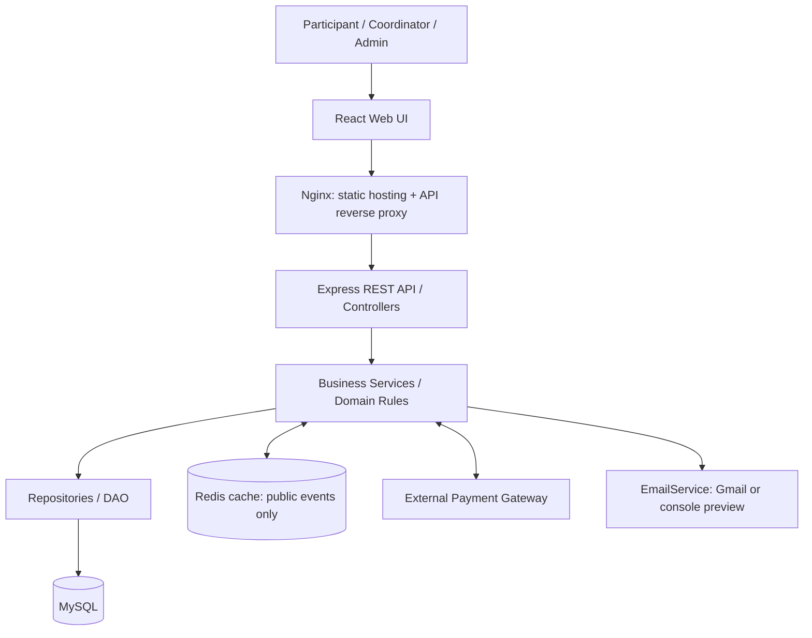

# FestConnect Architecture

## 1. Selected architecture

FestConnect uses a **Layered Architecture with a modular backend**. Business functions are modules inside one backend application, not separate microservices.

## 2. Layers

### Presentation layer
React + TypeScript UI for participant, coordinator and admin flows. It renders public event content and calls REST endpoints. It contains no authoritative business rules.

### Edge/API access layer
Nginx serves the frontend and routes `/api/` requests to the backend for the local demonstration. In the logical system, load-balancer and API-Gateway responsibilities are distinct: load balancing distributes traffic; gateway logic routes requests, applies rate limiting and participates in authentication enforcement. The backend always owns final authorization. A single local Nginx/API instance should not be claimed to prove multi-instance balancing.

### API layer
Express routes/controllers translate HTTP requests and responses, validate shape, invoke services and apply authentication/role middleware.

### Business/domain layer
Services and FA1 domain responsibilities implement event/team/registration rules, schedule checks, payment state transitions and pass generation.

### Persistence layer
Repositories/DAO use parameterized MySQL queries and migrations. They are the only application layer that performs SQL.

### Data layer
MySQL is authoritative for participants, coordinators, events, teams, members, schedules, registrations, payments and passes. Redis is an optional cache for public event listings/details only.

### External integrations
Payment is isolated behind a `PaymentGateway` interface and adapter. Gmail email delivery is isolated behind an `EmailService` interface; a console adapter works locally without credentials. No Kafka/message broker is included.

## 3. Proposed dependency direction

`React UI → API routes/controllers → application services/domain rules → repository/DAO → MySQL`

External calls:
- `PaymentService → PaymentFactory → PaymentProcessor / PaymentGatewayAdapter → configured gateway`
- `ScheduleService → ScheduleObserver → EmailNotificationObserver → EmailService → Gmail SMTP or console adapter`
- `Event query service → Redis cache (optional) → MySQL on cache miss`

Services should depend on interfaces for external I/O. The UI must never connect directly to the database or email provider.

## 4. Main module responsibilities

- **Auth module:** register/login/logout/current user, role/ownership middleware.
- **Event module:** public catalogue, details, coordinator CRUD, event status/rules.
- **Team module:** create team, leader, membership rules and lookups.
- **Schedule module:** event schedule persistence and conflict checks.
- **Registration module:** validate registration, ensure uniqueness and maintain status.
- **Payment module:** compute amount from server-side registration/event data, create attempt, verify provider response, enforce idempotency.
- **Pass module:** create/retrieve pass only after payment/registration criteria are satisfied.
- **Notification module:** send/preview email without coupling email behavior to schedule logic.

## 5. State and consistency rules

### Registration
Suggested statuses include `PENDING_PAYMENT`, `CONFIRMED` and `CANCELLED`, subject to exact FA1/business rules. Valid transitions must be enforced by services and database transactions.

### Payment
Suggested statuses: `PENDING`, `SUCCESS`, `FAILED`, `REFUNDED` if refund scope is approved. A participant must never directly set `SUCCESS`. Verification is server-side and idempotent.

### Pass
Create a `PassReceipt` once the associated registration meets the success criteria. The pass lookup must check user ownership or coordinator/admin permission.

### Registration duplicate rule
If the FA1 design defines one team may register only once for an event, use application validation and a unique database constraint on `(team_id, event_id)`. Confirm against the original FA1 model before enforcing.

## 6. Caching

Use cache-aside with Redis for public event listing/detail responses. Key examples: `events:list:<normalized filters>` and `events:detail:<eventId>`. Default TTL is 60 seconds. Invalidate relevant entries after event create/update/delete or schedule/status changes. If Redis is unavailable, fall back to MySQL. Never publicly cache authorization-sensitive records.

## 7. Deployment model

### Local demo
- `web`: Nginx container serves React static build.
- `api`: Express layered backend container.
- `mysql`: MySQL-compatible server with persistent volume.
- `redis`: optional cache container.
- External payment provider and Gmail remain outside Compose.

Nginx can serve the frontend and reverse-proxy `/api/` in the compact local demo. For a multi-instance demonstration/production environment, configure a distinct or expanded load-balancing layer and run identical stateless API instances. Do not claim the single-instance Compose setup demonstrates horizontal scaling.

## 8. Diagram

## 9. Decisions intentionally not included

No mobile app, microservices, Kafka, service registry, configuration server, separate CI/CD system, monitoring stack, centralized log product, or Vault/AWS KMS component in MVP. Basic logs, environment configuration, secure credential handling, tests and health checks remain part of normal application quality.
