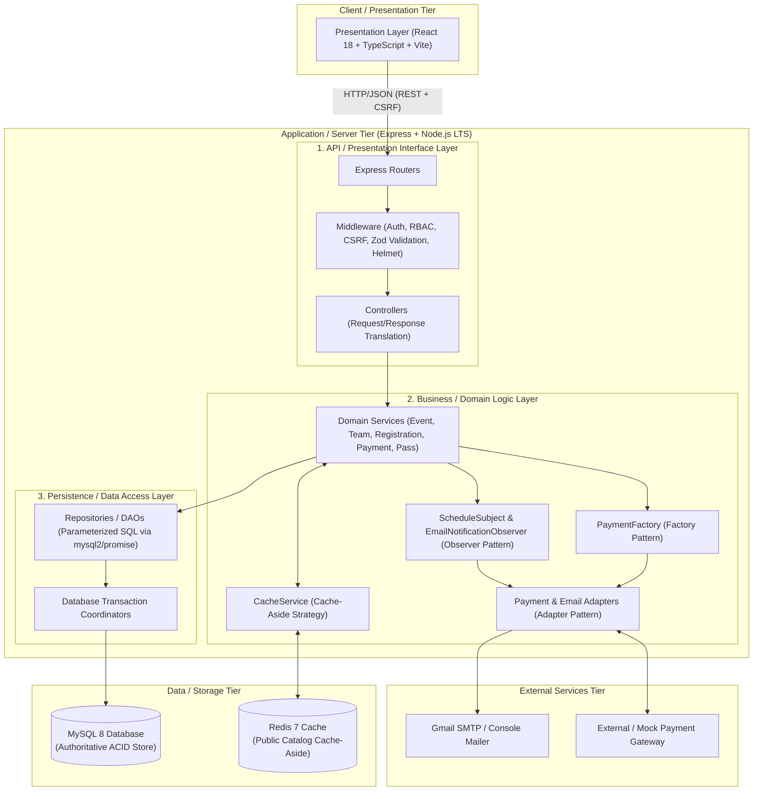
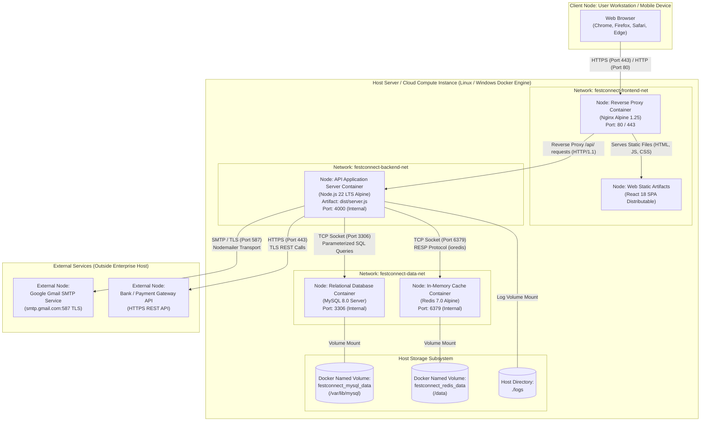

# FestConnect — Layered Software Architecture & Deployment Architecture

**Course:** Object Oriented Modelling and System Design (BCER27PC02)  
**Project:** FestConnect — Centralized Technical Fest & Event Registration System  
**Document Version:** 1.0.0  
**Date:** October 2026  

---

## 1. Software Architecture Pattern: Layered Architecture

### 1.1 Architectural Pattern Overview
FestConnect adopts the **Layered Architecture Pattern** (also known as the **N-Tier Architecture Pattern**) configured as a **Modular Monolith**. Rather than fragmenting the domain into loosely governed, distributed microservices (which introduce distributed transactions, network latency, and operational fragility), the entire application is architected into logically distinct, horizontally separated layers with strict, unidirectional dependency flows.



---

### 1.2 The Five Architectural Layers in Detail

#### Layer 1: Presentation Layer (`apps/web`)
* **Role & Scope:** The user interface executed within the user's web browser. It renders interactive screens for participants, event coordinators, and administrators.
* **Technology Stack:** React 18, TypeScript, Vite, CSS Modules with university design tokens, React Router v6.
* **Responsibilities:**
  - Rendering responsive UI components, event catalogs, registration forms, team dashboards, payment modals, and digital QR passes.
  - Client-side navigation, form state tracking, and user feedback (loading spinners, alert modals, error messages).
  - Secure communication with the API via the standard Fetch API, including automatic inclusion of cookies (`credentials: 'include'`) and anti-CSRF request headers (`x-csrf-token`).
* **Architectural Invariant:** **Strictly Non-Authoritative**. The presentation layer never computes final payment amounts, never issues pass receipts directly, never enforces permissions independently, and never communicates directly with the database or external third parties.

#### Layer 2: API & Controller Interface Layer (`apps/api/src/routes`, `controllers`, `middleware`)
* **Role & Scope:** The HTTP boundary of the server. It handles incoming HTTP requests, terminates transport-level security, parses payloads, validates formats, enforces perimeter security, and routes requests to appropriate domain controllers.
* **Key Components:**
  - **Security & Perimeter Middleware:**
    - `helmet`: Sets HTTP security headers (CSP, HSTS, X-Content-Type-Options).
    - `cors`: Strict origin validation against the configured client origin (`http://localhost:5173`).
    - `csrfProtection`: Validates double-submit CSRF cookie tokens on all state-mutating HTTP methods (`POST`, `PUT`, `PATCH`, `DELETE`).
  - **Authentication & RBAC Middleware:**
    - `authenticate`: Decodes and verifies the signed JWT from the HttpOnly `festconnect_token` cookie.
    - `requireAuth`: Rejects unauthenticated requests with HTTP 401 Unauthorized.
    - `requireRole('ADMIN', 'COORDINATOR')`: Enforces role-based access control with HTTP 403 Forbidden.
  - **Input Validation Middleware:**
    - `validateBody`, `validateQuery`, `validateParams`: Enforces declarative Zod schemas; rejects malformed inputs with structured HTTP 400 Bad Request error arrays.
  - **Controllers:**
    - Translate HTTP payloads into typed DTOs (Data Transfer Objects).
    - Delegate execution to domain services.
    - Map service responses and domain exceptions to standardized HTTP status codes (`200 OK`, `201 Created`, `400 Bad Request`, `401 Unauthorized`, `403 Forbidden`, `404 Not Found`, `409 Conflict`, `500 Internal Server Error`).

#### Layer 3: Business & Domain Logic Layer (`apps/api/src/services`)
* **Role & Scope:** The heart of the system. Implements core university fest business rules, workflow orchestrations, transactional lifecycles, and cryptographic operations.
* **Key Domain Modules:**
  - `AuthService`: Password hashing via `bcryptjs`, JWT payload signing/verification, participant registration restrictions.
  - `EventService`: Public event catalog discovery, event creation/updates, coordinator ownership validation, Redis cache invalidation.
  - `TeamService`: Team creation, team leader assignment, member addition/removal limits, team status enforcement.
  - `RegistrationService`: Event availability checks, duplicate registration guards, team size boundary checks, transactional registration creation.
  - `PaymentService`: Server-authoritative fee computation, payment attempt logging, idempotency verification, registration state transition (`PENDING_PAYMENT` → `CONFIRMED`).
  - `PassService`: Cryptographic HMAC-SHA256 digital pass generation, visual QR code generation (`data:image/png;base64`), gate pass verification, access check.
  - `ScheduleService`: Event date/time validations, venue schedule tracking, observer event dispatching.
* **Integrated Software Design Patterns:**
  1. **Factory Pattern (`PaymentFactory`):** Decouples the application from concrete payment processors. Dynamically selects between mock gateway adapters and production payment gateways based on environment configuration.
  2. **Adapter Pattern (`PaymentGatewayAdapter`, `EmailServiceAdapter`):** Converts third-party vendor interfaces (e.g., Gmail SMTP or mock payment endpoints) into domain-standard interfaces (`PaymentGateway`, `EmailService`), allowing seamless switching between local console previews and remote SMTP without altering business logic.
  3. **Observer Pattern (`ScheduleSubject`, `ScheduleObserver`):** Implements a publish-subscribe notification mechanism. When an event coordinator updates an event schedule, `ScheduleService` publishes a `ScheduleChangeEvent`; `EmailNotificationObserver` captures the event asynchronously and queues participant notification emails without blocking the HTTP request or rolling back schedule changes if an email fails.
  4. **Cache-Aside Pattern (`CacheService`):** Orchestrates read-through caching and pattern-based invalidation for public event listings and schedules with automated failover to MySQL on Redis outages.

#### Layer 4: Persistence & Data Access Layer (`apps/api/src/repositories`)
* **Role & Scope:** Encapsulates all relational database interaction. Exposes domain-centric collection operations (e.g., `findById`, `findByTeamAndEvent`, `create`, `update`).
* **Key Components:**
  - `EventRepository`, `ScheduleRepository`, `CoordinatorRepository`, `TeamRepository`, `RegistrationRepository`, `PaymentRepository`, `PassRepository`, `ParticipantRepository`, `EmailNotificationRepository`.
* **Architectural Guarantees:**
  - **100% Parameterized Queries:** Every SQL query is parameterized using `?` placeholders via `mysql2/promise`. String concatenation of user input is strictly prohibited, providing absolute SQL injection defense.
  - **Transaction Support:** Coordinates multi-step atomic operations (e.g., creating registration + initial audit log; recording payment attempt + updating registration status + issuing pass receipt) within managed database transactions (`conn.beginTransaction()`, `conn.commit()`, `conn.rollback()`).

#### Layer 5: Data & Infrastructure Storage Layer (`MySQL 8`, `Redis 7`)
* **Role & Scope:** The physical persistence and caching engines.
* **Engines:**
  - **MySQL 8.0:** Authoritative ACID relational data store. Enforces table schemas, primary keys, foreign key constraints (`ON DELETE RESTRICT/CASCADE`), composite indexes, and versioned migrations (`001_initial_fa1_schema.sql`, `002_email_notifications.sql`, `003_database_tuning.sql`).
  - **Redis 7.0:** In-memory key-value cache layer configured for cache-aside read optimization of public event catalogs. Holds ephemeral JSON strings with a 60-second TTL.

---

### 1.3 Strict Unidirectional Dependency Invariant
In accordance with layered architecture principles, dependencies flow strictly downwards:
$$\text{Presentation Layer} \longrightarrow \text{API Layer} \longrightarrow \text{Business Logic Layer} \longrightarrow \text{Persistence Layer} \longrightarrow \text{Data Layer}$$

* **Forbidden Cross-Layer Leaks:**
  - The Presentation Layer never communicates directly with Repositories or MySQL.
  - The API/Controller Layer contains no business validation logic or raw SQL queries.
  - Domain Services never accept raw Express `req` or `res` objects; they receive typed DTOs and return typed domain records.
  - Repositories never construct HTTP responses or make authorization decisions.

---

## 2. UML Deployment Architecture

### 2.1 Deployment Context & Topological Nodes
The FestConnect deployment architecture defines how software artifacts are mapped onto execution environments, physical/virtual hardware nodes, execution containers, network topologies, and persistent volumes.



---

### 2.2 Detailed Node Specifications

| Node / Container Name | Execution Environment | Artifact Landed | Open Ports | Volume Mounts | Responsibilities |
| :--- | :--- | :--- | :--- | :--- | :--- |
| **`Client Device`** | User OS (Windows, macOS, Linux, Android, iOS) | Modern Web Browser | 80/443 outbound | Local browser storage, cookies | Executes client-side React SPA, maintains session cookie, renders UI. |
| **`Nginx Reverse Proxy`** (`web`) | Alpine Linux Docker Container | Nginx 1.25, compiled static assets (`apps/web/dist`) | `80:80`, `443:443` | Optional SSL certificates | SSL termination, serving static React assets, reverse-proxying `/api/` traffic to API container, gzip compression. |
| **`API Application Server`** (`api`) | Node.js 22 LTS Alpine Docker Container | Compiled TypeScript bundle (`apps/api/dist/server.js`) | `4000` (internal bridge only) | `./logs:/app/logs` | Executes Express REST application, JWT validation, business workflows, pass crypto signing, database transactions. |
| **`Relational Database`** (`mysql`) | Oracle Linux / Debian MySQL 8.0 Container | MySQL Server 8.0 Daemon (`mysqld`) | `3306` (isolated backend net) | `festconnect_mysql_data:/var/lib/mysql` | Authoritative transactional persistence, schema migrations, foreign key cascading, index lookups. |
| **`In-Memory Cache`** (`redis`) | Alpine Linux Redis 7.0 Container | Redis Server Daemon (`redis-server`) | `6379` (isolated backend net) | `festconnect_redis_data:/data` | Ephemeral caching for public event lists and schedules; sub-millisecond read access; safe cache-aside invalidation. |
| **`External SMTP Service`** | Google Cloud / Gmail Mail Exchange | Postfix / Gmail SMTP Server | Outbound `587` (TLS) | Managed by Google | Delivers registration confirmation emails and digital pass notifications to participants. |
| **`External Payment Gateway`** | Bank / Mock Gateway Cloud Infrastructure | PCI-DSS Compliant Gateway API | Outbound `443` (HTTPS) | Managed by Provider | Card processing, UPI processing, webhook notifications, payment capture. |

---

### 2.3 Network Segmentation & Security Zones
The deployment model partitions containers into three isolated virtual bridge networks:

1. **`festconnect-frontend-net` (DMZ):**
   - Contains only the public-facing Nginx reverse proxy.
   - The only network with ports bound to the host network interface (`0.0.0.0:80`, `0.0.0.0:443`).
2. **`festconnect-backend-net` (Application Zone):**
   - Connects the Nginx reverse proxy and the `api` container.
   - External internet users cannot address the Node.js application server directly.
3. **`festconnect-data-net` (Data Isolation Zone):**
   - Connects the `api` container, `mysql` container, and `redis` container.
   - The database and cache instances expose **no ports to the public internet**; only the `api` container can initiate TCP connections to port 3306 or 6379.

---

### 2.4 Data Persistence & Backup Strategy
- **Relational Persistence:** Backed by Docker named volume `festconnect_mysql_data`. Even when containers are stopped, removed, or updated via `docker compose down`, all participant accounts, team structures, registrations, payment records, and audit logs remain intact on host block storage.
- **Cache Persistence:** Backed by Docker named volume `festconnect_redis_data` utilizing Redis Append-Only File (AOF) / RDB snapshotting. If the Redis container restarts, cache state is restored without imposing sudden cold-cache thundering herd load on MySQL.
- **Fail-Safe Operation:** If Redis is completely destroyed or offline, the API layer's non-blocking error-handling catches connection errors and seamlessly routes queries directly to MySQL without 500 errors.

---

## 3. Summary of Architectural Advantages
1. **Separation of Concerns:** Clear demarcation between Presentation, API, Domain, Persistence, and Storage layers prevents spaghetti code and simplifies codebase onboarding.
2. **Independent Testability:** Repositories and external adapters can be mocked cleanly in unit and integration test suites (demonstrated by 297 passing tests across 20 suites).
3. **High Security Posture:** Parameterized SQL queries, HttpOnly double-submit CSRF cookies, HMAC-SHA256 digital pass signing, server-side authoritative state computation, and network segmentation provide enterprise-grade defense-in-depth.
4. **Operational Simplicity:** A single Docker Compose bundle can reproduce the entire multi-tier system on any standard workstation with zero manual tool installations.

---

## 4. Verified Container Deployment & Operational Runbook

### A. Verified Startup Commands
To start the entire FestConnect production stack in detached mode:
```bash
docker compose -p festconnect up -d --build
```

To inspect container statuses:
```bash
docker compose -p festconnect ps
```

To view live container logs:
```bash
docker compose -p festconnect logs -f api
docker compose -p festconnect logs -f web
```

To perform a clean shutdown preserving database & cache volumes:
```bash
docker compose -p festconnect down
```

### B. Health & Readiness Probes
All services feature automated Docker health checks and HTTP probes:

| Target | URL / Probe | Expected Status | Purpose |
| :--- | :--- | :--- | :--- |
| **Web SPA (Port 80)** | `GET http://localhost/` | `HTTP 200 OK` | Verifies Nginx delivers React Vite bundle |
| **API Liveness** | `GET http://localhost/api/health` | `HTTP 200 OK` | Verifies Express server event loop |
| **Database Readiness** | `GET http://localhost/api/ready` | `HTTP 200 OK` | Verifies MySQL connection pool connectivity |
| **MySQL Service** | `mysqladmin ping` | `Exit Code 0` | Verifies MySQL socket readiness |
| **Redis Service** | `redis-cli ping` | `PONG` (Exit Code 0) | Verifies Redis cache engine readiness |

### C. Verified Resilience & Persistence Evidence
1. **Data Durability Across Restarts:** MySQL named volume `festconnect_mysql_data` verified persistent across container restarts (`docker compose -p festconnect restart mysql api`). Migrations are verified idempotent (skips 001, 002, 003 without errors).
2. **Redis Outage Fallback:** Verified when the Redis container is completely stopped (`docker compose -p festconnect stop redis`), public event catalog and event detail requests seamlessly fall back to MySQL and return `HTTP 200 OK` without error.
3. **Network Isolation:** Verified database port `3306` and Redis port `6379` are internal to `festconnect-data-net` with `internal: true` and are **not bound to host interfaces**. The only exposed port is web entrypoint port `80`.

